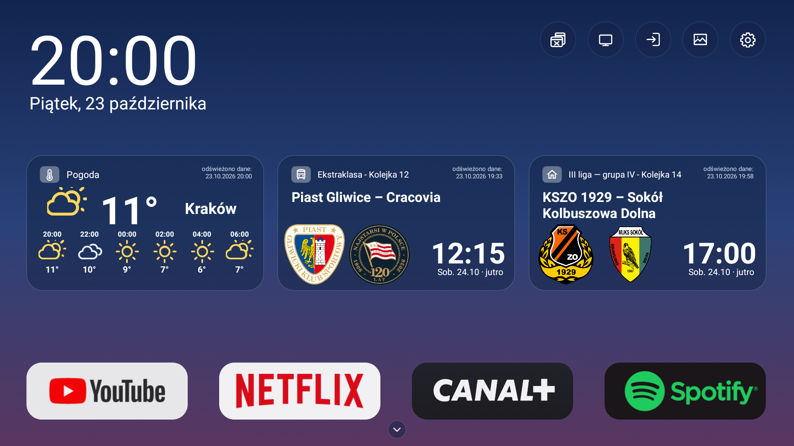

<p align="center">
  <picture>
    <source media="(prefers-color-scheme: dark)" srcset="docs/brand/linartv-header-dark.svg">
    
  </picture>
</p>

<p align="center">
  <a href="https://github.com/domlin92/linartv-launcher-open/releases/latest"></a>
  <a href="LICENSE"></a>
  
</p>

<p align="center"><a href="#english">English</a> · <a href="#polski">Polski</a></p>

<p align="center"></p>

---

## English

**LinarTV** is a clean, fast home screen for Android TV built around Polish football. It shows the clock, the weather for your city and the next matches of one or two clubs you follow — and keeps your favourite apps one click away.

### Features
- **Your clubs' fixtures** — pick one or two teams from Ekstraklasa, I liga, II liga or any of the four III liga groups on [kalendarzeligowe.pl](https://kalendarzeligowe.pl); fixtures update daily, with club crests.
- **Weather for Polish cities** — current model conditions, hourly and 7-day forecast with weather icons from IMGW-PIB.
- **Day and night modes**, app dock and full app drawer, quick access to TV inputs.
- **Polish or English interface** and Celsius or Fahrenheit temperature, selectable in LinarTV settings.
- **Wallpapers from your phone** — scan a QR code and upload photos over your home Wi-Fi (6-digit code, attempt limit).
- **Screensaver** with your photos after 5 minutes of inactivity.

### Install with Downloader (no computer needed)
The first signed APK and Downloader code are being prepared. Until the first release appears, build a debug APK from source.
1. On the TV, install **Downloader** by AFTVnews from the Play Store.
2. Open it and enter the code published here after the first release.
3. Install the APK (allow *Install unknown apps* for Downloader when asked).
4. Open **LinarTV** from the apps row. To make it your home screen, see your TV's *Default home* / *Home screen* settings.

Or download `LinarTV.apk` directly from [Releases](https://github.com/domlin92/linartv-launcher-open/releases/latest).

### Install with an AI coding assistant (Codex, Claude Code)
Open this repository in Codex, Claude Code or a similar tool and ask, for example: *"Install LinarTV on my Android TV"* (give it the TV's IP address from the TV's network settings). The assistant follows [AGENTS.md](AGENTS.md): it checks the tools, builds or downloads the APK, connects with `adb`, installs the app and — only after asking you — sets it as the home screen, keeping the commands to restore the original launcher. Enable developer options and network debugging on the TV first (Settings → Device Preferences → About → click *Build* 7 times).

How it works and where the data comes from: [docs/FUNCTIONAL.md](docs/FUNCTIONAL.md) (in Polish, with UML diagrams).

### Build from source
JDK 17 and the Android SDK are required (`JAVA_HOME`, `ANDROID_HOME`).
```text
./gradlew :app:assembleDebug
```
Signed releases: see [docs/RELEASING.md](docs/RELEASING.md).

### Credits
- Inspired by and started inside [Clean Your TV](https://cleanyour.tv/) by Gathin (MIT).
- Fixtures: [kalendarzeligowe.pl](https://kalendarzeligowe.pl) — used with the site owner's permission.
- Weather data and icons: IMGW-PIB (meteo.imgw.pl). The data have been processed.
- Polish city search: Open-Meteo geocoding / GeoNames (CC BY 4.0), used only to find coordinates.
- Weather Icons font by Erik Flowers (SIL OFL 1.1).
- Weather symbols use IMGW's day and night variants.
- Club crests belong to their clubs — see [docs/CRESTS.md](docs/CRESTS.md).

### License
Code: [MIT](LICENSE). Club crests and third-party logos are not covered by the code license.

---

## Polski

**LinarTV** to czytelny, szybki ekran główny dla Android TV z myślą o polskiej piłce. Pokazuje zegar, pogodę dla Twojego miasta i najbliższe mecze jednego lub dwóch klubów — a ulubione aplikacje są zawsze pod ręką.

### Funkcje
- **Terminarz Twoich klubów** — wybierz jedną lub dwie drużyny z Ekstraklasy, I ligi, II ligi lub dowolnej z czterech grup III ligi na [kalendarzeligowe.pl](https://kalendarzeligowe.pl); terminarze odświeżają się codziennie, z herbami klubów.
- **Pogoda dla miast w Polsce** — aktualne warunki modelowe, prognoza godzinowa i 7-dniowa oraz ikony IMGW-PIB. Miasto zmienisz w *Ustawieniach*.
- **Tryb dzienny i nocny**, pasek aplikacji i pełna lista aplikacji, szybki dostęp do źródeł TV.
- **Język polski lub angielski** oraz temperatura w stopniach Celsjusza lub Fahrenheita, wybierane w ustawieniach LinarTV.
- **Tapety z telefonu** — zeskanuj kod QR i wyślij zdjęcia przez domowe Wi-Fi (6-cyfrowy kod z limitem prób).
- **Wygaszacz** z Twoimi zdjęciami po 5 minutach bezczynności.

### Instalacja z asystentem AI (Codex, Claude Code)
Otwórz to repozytorium w Codex, Claude Code lub podobnym narzędziu i poproś np.: *„Zainstaluj LinarTV na moim telewizorze”* (podaj adres IP telewizora z jego ustawień sieci). Asystent korzysta z [AGENTS.md](AGENTS.md): sprawdza narzędzia, buduje lub pobiera APK, łączy się przez `adb`, instaluje aplikację i — dopiero po Twojej zgodzie — ustawia ją jako ekran główny, zapisując polecenia przywracające fabryczny launcher. Wcześniej włącz na TV opcje programisty i debugowanie sieciowe (Ustawienia → Ustawienia urządzenia → Informacje → 7× *Kompilacja*).

Opis działania i źródeł danych: [docs/FUNCTIONAL.md](docs/FUNCTIONAL.md) (z diagramami UML).

### Instalacja przez Downloader (bez komputera)
Pierwszy podpisany APK i kod Downloadera są w przygotowaniu. Do tego czasu możesz zbudować testowy APK ze źródeł.
1. Na telewizorze zainstaluj **Downloader** (AFTVnews) ze Sklepu Play.
2. Otwórz go i wpisz kod, który opublikujemy tutaj po pierwszym wydaniu.
3. Zainstaluj APK (zezwól Downloaderowi na *instalowanie nieznanych aplikacji*).
4. Uruchom **LinarTV** z listy aplikacji. Aby ustawić go jako ekran główny, poszukaj w ustawieniach TV opcji *Domyślny ekran główny*.

Plik `LinarTV.apk` możesz też pobrać bezpośrednio z [Releases](https://github.com/domlin92/linartv-launcher-open/releases/latest).

### Budowanie
Wymagane: JDK 17 i Android SDK (`JAVA_HOME`, `ANDROID_HOME`).
```text
./gradlew :app:assembleDebug
```
Podpisane wydania: [docs/RELEASING.md](docs/RELEASING.md). Plan prac: [docs/ROADMAP.md](docs/ROADMAP.md).

### Podziękowania
- Projekt powstał na bazie i z inspiracji [Clean Your TV](https://cleanyour.tv/) (Gathin, MIT).
- Terminarze: [kalendarzeligowe.pl](https://kalendarzeligowe.pl) — za zgodą właściciela serwisu.
- Pogoda i ikony: IMGW-PIB (meteo.imgw.pl). Dane IMGW-PIB zostały przetworzone.
- Wyszukiwanie polskich miejscowości: geokodowanie Open-Meteo / GeoNames (CC BY 4.0), wyłącznie do ustalania współrzędnych.
- Font Weather Icons: Erik Flowers (SIL OFL 1.1).
- Symbole pogody pochodzą z IMGW i uwzględniają porę dnia.
- Herby należą do klubów — zobacz [docs/CRESTS.md](docs/CRESTS.md).

### Licencja
Kod: [MIT](LICENSE). Herby klubów i logo innych firm nie są objęte licencją kodu.
